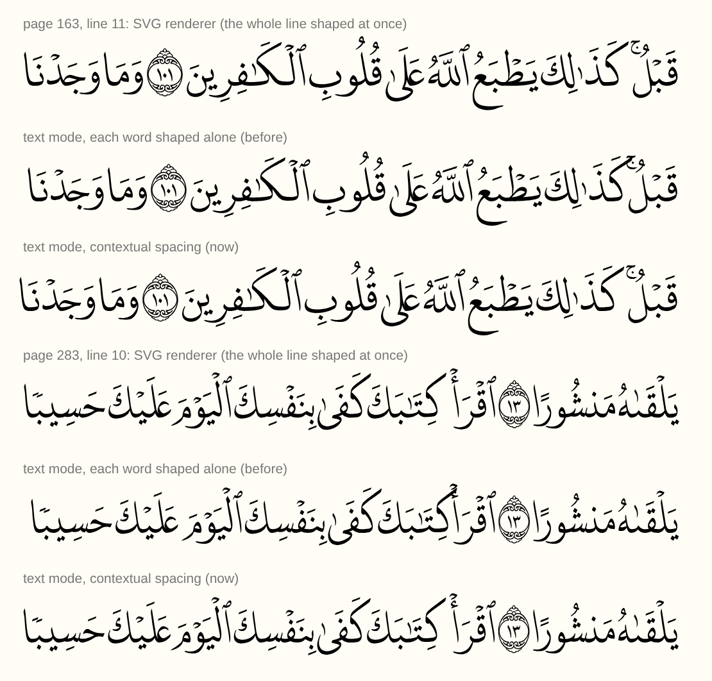

# Text mode: justified pages as real HTML text

The HarfBuzz renderer (`hbmedina`) draws every page as SVG glyphs. That looks
exactly right, but the page is not text: it can't be selected, searched,
copied, read by a screen reader or restyled with CSS.

These tools let the same justified layout be shown as **real HTML text**, with
the letters stretched exactly as `justifyLine()` decides. They work with the
app's own texts and the existing fonts (New Madina, Old Madina, IndoPak), and
change nothing in the app.

## Why fonts need a small addition

`justifyLine()` stretches single letters with `cv01`/`cv02`/`cv10`–`cv18` on one
character. In HTML, a feature can only be set per element:

- wrapping one letter in its own `<span>` breaks the joining;
- even with ZWJ around the span, kerning and cursive attachment across the span
  edges are lost, so words drift by up to 12px at 40px.

But stretching **never changes how many glyphs a word has** (checked on every
stretched word of all three layouts). So a stretched word can be described as
"the glyph at position *k* becomes glyph *g′*". `patch_font.py` adds to a copy
of the font:

- one `AlternateSubst` lookup: glyph → its stretched variants, and
- features `jp01`…`jpNN`: `jpKK` swaps the glyph at position *KK* of the word,
  the feature **value** choosing the variant.

The new lookups run after all existing ones, so GPOS (kerning, cursive, marks)
positions exactly the glyphs `justifyLine()` produces. A whole word is one span:

```html
<span style='font-feature-settings: "jp04" 3, "jp06" 1'>كَفَرُوا۟</span>
```

## Spacing: the same ink gaps as the SVG renderer

The SVG renderer shapes a whole line in one HarfBuzz buffer, so the font's
contextual positioning also works *across* a space. For example, a word-initial
kaf after a pause mark gets an extra 100 units, so its top stroke clears the
mark. A span is shaped on its own and loses that. In New Madina, 88 word pairs
at font scale 1 overlapped in text mode that are clear in the SVG renderer.

`textModeLine()` therefore shapes the whole line too, as `renderLine()` does,
and measures the ink distance between each pair of words: band by band, with
outlines from `glyphToSvgPath` (`src/ink.ts`). It then corrects each space so
the distance in the DOM is the same. The line keeps its width: any difference
is spread evenly over its spaces. This is on by default; pass
`{ contextualSpacing: false }` to turn it off.



## Overfull lines

When a line is wider than its width (`xScale < 1`), the SVG renderer scales the
whole line, and `textModeLine()` does the same by default. With
`{ overfull: "words" }`, the words are narrowed instead (`transform: scaleX`
on each word span, down to `minWordScale`, default 0.8). Aya numbers and spaces
keep their size, as on dense lines of the printed mushaf. Only what is left
goes to the line. Spaces then account for the narrowed words' boxes, and may
be negative: the boxes overlap but the ink never does.

## Usage

```sh
cd tools/textmode
npm install
npm run bundle                        # builds dist/ from src/ + the app's own .ts files

# 1. record every glyph -> stretched glyph the justifier produces
#    (whole text, font-scale slider range 0.5..1.2)
node dist/collect.mjs --layout newmadina --scales 0.5:1.2:0.025

# 2. add the jpNN features to a copy of the font (needs Python + fontTools)
python3 patch_font.py ../../ClientApp/src/assets/fonts/hb/madina.otf \
    out/newmadina-stretch.json out/madina-textmode.otf

# 3. verify (see below)
node dist/verify.mjs --layout newmadina
node dist/browser-check.mjs --layout newmadina --page 3   # needs `npx playwright install chromium`
node dist/inkcheck.mjs --layout newmadina                   # word spacing vs the SVG renderer
node dist/check-breaks.mjs --layout newmadina [--reference path/to/quran-qcf4/package]
```

`./run_all.sh` runs all of these for `newmadina`, `oldmadina` and `indopak`.

In the app, `src/textmode.ts` turns one `justifyLine()` result into per-word
CSS (`textModeLine()`) and HTML (`textModeLineHtml()`). It only needs
`harfbuzz.ts`, the patched font and the `*-stretch.json` table.

## Tests

`verify` runs the app's own `justifyLine()` over **every justified line** at
several font scales (including scales that were not used to build the table)
and, for every stretched word, shapes it twice:

| | font | features |
|---|---|---|
| reference | original | the app's per-character `cvNN` |
| text mode | patched | the word's `jpNN` only |

It passes only if the glyph ids, advances and offsets are **identical** for
every glyph, and every line's words + spaces add up to the line width.

`inkcheck` lays out every justified line in text mode and measures, band by
band, how close each pair of neighbouring words comes. It compares that with
the same pair in the SVG renderer. It fails if any gap differs by more than 1
unit (after allowing for the few lines the SVG renderer leaves a little short),
or if two words touch in text mode but not in the SVG renderer.

`browser-check` renders a page in Chromium (or Firefox/WebKit if installed). It
compares each word's rendered width with HarfBuzz (0.1px tolerance) and where
the browser puts each word in its line (0.3px: each inline-block space is
snapped to 1/64px).

## Results

Table built over font scales 0.5–1.2 (step 0.05), verified at 1, 0.53, 0.73,
0.88, 1.07 and 1.18 — most of them **not** used to build the table:

| layout | lines × scales | stretched words checked | glyph-identical | unexpressible (shown unstretched) | lines filling their width |
|---|---|---|---|---|---|
| newmadina | 52,926 | 157,663 | **157,663 (100%)** | 2 of 502,038 words | 100% |
| oldmadina | 52,926 | 176,754 | **176,754 (100%)** | 2 of 502,044 words | 100% |
| indopak | 53,436 | 151,074 | **151,074 (100%)** | 0 of 502,044 words | 100% |

Chromium (`browser-check`): every word within **0.016px** of HarfBuzz at 40px
(newmadina pages 3, 50, 300 at scales 1, 1.1, 0.8; oldmadina and indopak pages
3 and 300). Every word is also placed within **0.09px** of where HarfBuzz puts
it (0.22px with `overfull: "words"`).

Word spacing (`inkcheck`, every justified line at font scale 1; "touching"
means closer than 10 units, 1% of an em, where the SVG renderer has them apart):

| layout | word gaps | touching, words shaped alone | touching, contextual spacing | gaps ≠ SVG renderer | touching, `overfull: "words"` |
|---|---|---|---|---|---|
| newmadina | 74,852 | 88 | **0** | **0** | **0** |
| oldmadina | 74,853 | 177 | **0** | **0** | **0** |
| indopak | 74,768 | 1 | **0** | **0** | **0** |

A few lines (14 in New Madina, 164 in Old Madina, 4 in IndoPak) come out of
the SVG renderer slightly short of their width. Text mode always fills the
width, so on those lines the gaps are compared after removing that difference.
The 2 New Madina and 5 Old Madina gaps that touch in the SVG renderer itself
are on the basmala of pages 1 and 2, which is drawn that way on purpose.


## Line breaks of the texts

`check-breaks` reads the layout texts (`quran_text_*.ts`) as they are.

- An aya number at the start of a line: 573 lines in New Madina and 566 in
  Old Madina; IndoPak has 1.
- With `--reference`, New Madina's lines are compared word by word with King
  Fahd Complex's page data for the 1441H Madina Mushaf, in the layout of the
  `quran-qcf4` npm package (JSON under MIT; the tool only reads it). In that
  data no line starts with an aya number. Of 8,820 text lines, 7,185 match
  exactly. 857 differ only in which line an aya number sits on. 778 have
  words on a different line (e.g. page 579, lines 3–4).

This is reported, not changed: text mode follows whatever the texts say.

## Notes

- The table depends on the text and the justifier: if either changes, re-run
  `collect` and `patch_font.py`. A word whose stretch is not in the table is
  reported as `unsupported` and shown unstretched (its line then gets slightly
  wider spaces), so pages still render correctly.
- Shrunk lines (`xScale < 1`) are drawn with `transform: scaleX()`, like the
  SVG renderer, unless `overfull: "words"` is set.
- Safari/CoreText: custom feature tags with values are untested.
- The patched fonts are OFL like the originals; their family name gets a
  ` TextMode` suffix.
