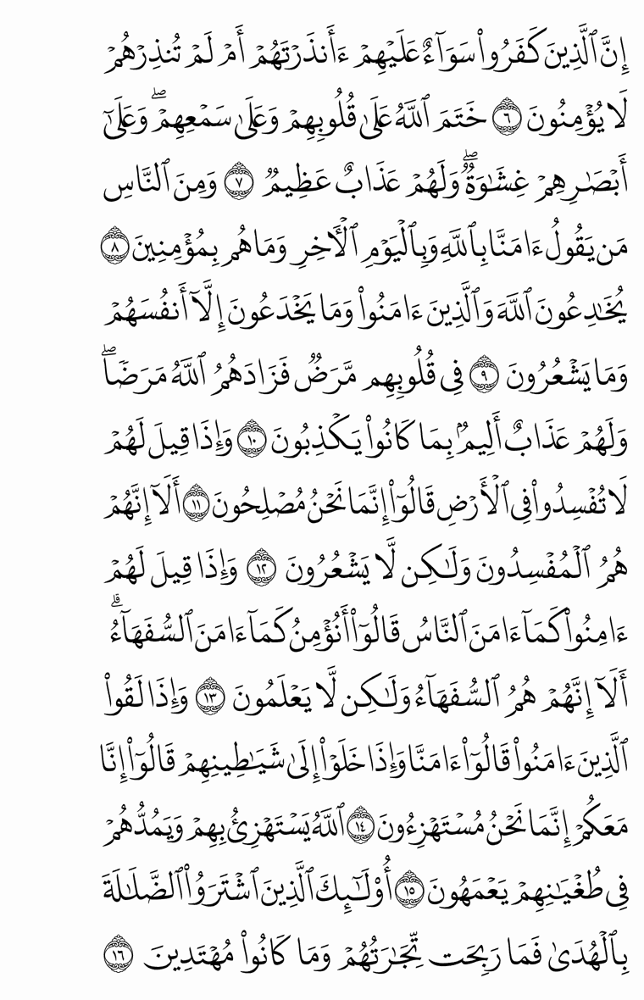

# Text mode: justified pages as real HTML text

The HarfBuzz renderer (`hbmedina`) draws every page as SVG glyphs. That looks
exactly right, but the page is not text: it can't be selected, searched,
copied, read by a screen reader or restyled with CSS.

These tools let the same justified layout be shown as **real HTML text**, with
the letters stretched exactly as `justifyLine()` decides. They work with the
app's own texts and the existing fonts (New Madina, Old Madina, IndoPak), and
change nothing in the app.

## Why fonts need a small addition

`justifyLine()` stretches single letters with `cv01`/`cv02`/`cv10`–`cv18` on one
character. In HTML, a feature can only be set per element:

- wrapping one letter in its own `<span>` breaks the joining;
- even with ZWJ around the span, kerning and cursive attachment across the span
  edges are lost, so words drift by up to 12px at 40px.

But stretching **never changes how many glyphs a word has** (checked on every
stretched word of all three layouts). So a stretched word can be described as
"the glyph at position *k* becomes glyph *g′*". `patch_font.py` adds to a copy
of the font:

- one `AlternateSubst` lookup: glyph → its stretched variants, and
- features `jp01`…`jpNN`: `jpKK` swaps the glyph at position *KK* of the word,
  the feature **value** choosing the variant.

The new lookups run after all existing ones, so GPOS (kerning, cursive, marks)
positions exactly the glyphs `justifyLine()` produces. A whole word is one span:

```html
<span style='font-feature-settings: "jp04" 3, "jp06" 1'>كَفَرُوا۟</span>
```

## Usage

```sh
cd tools/textmode
npm install
npm run bundle                        # builds dist/ from src/ + the app's own .ts files

# 1. record every glyph -> stretched glyph the justifier produces
#    (whole text, font-scale slider range 0.5..1.2)
node dist/collect.mjs --layout newmadina --scales 0.5:1.2:0.025

# 2. add the jpNN features to a copy of the font (needs Python + fontTools)
python3 patch_font.py ../../ClientApp/src/assets/fonts/hb/madina.otf \
    out/newmadina-stretch.json out/madina-textmode.otf

# 3. verify (see below)
node dist/verify.mjs --layout newmadina
node dist/browser-check.mjs --layout newmadina --page 3   # needs `npx playwright install chromium`
```

`./run_all.sh` does steps 1–3 for `newmadina`, `oldmadina` and `indopak`.

In the app, `src/textmode.ts` turns one `justifyLine()` result into per-word
CSS (`textModeLine()`) and HTML (`textModeLineHtml()`). It only needs
`harfbuzz.ts`, the patched font and the `*-stretch.json` table.

## Tests

`verify` runs the app's own `justifyLine()` over **every justified line** at
several font scales (including scales that were not used to build the table)
and, for every stretched word, shapes it twice:

| | font | features |
|---|---|---|
| reference | original | the app's per-character `cvNN` |
| text mode | patched | the word's `jpNN` only |

It passes only if the glyph ids, advances and offsets are **identical** for
every glyph, and every line's words + spaces add up to the line width.

`browser-check` renders a page in Chromium (or Firefox/WebKit if installed)
and compares each word's rendered width with HarfBuzz.

## Results

Table built over font scales 0.5–1.2 (step 0.05), verified at 1, 0.53, 0.73,
0.88, 1.07 and 1.18 — most of them **not** used to build the table:

| layout | lines × scales | stretched words checked | glyph-identical | unexpressible (shown unstretched) | lines filling their width |
|---|---|---|---|---|---|
| newmadina | 52,926 | 157,663 | **157,663 (100%)** | 2 of 502,038 words | 100% |
| oldmadina | 52,926 | 176,754 | **176,754 (100%)** | 2 of 502,044 words | 100% |
| indopak | 53,436 | 151,074 | **151,074 (100%)** | 0 of 502,044 words | 100% |

Chromium (`browser-check`): every word within **0.016px** of HarfBuzz at 40px
(newmadina pages 3, 50, 300 at scales 1, 1.1, 0.8; oldmadina and indopak pages
3 and 300).



## Notes

- The table depends on the text and the justifier: if either changes, re-run
  `collect` and `patch_font.py`. A word whose stretch is not in the table is
  reported as `unsupported` and shown unstretched (its line then gets slightly
  wider spaces), so pages still render correctly.
- Shrunk lines (`xScale < 1`) are drawn with `transform: scaleX()`, like the
  SVG renderer.
- Safari/CoreText: custom feature tags with values are untested.
- The patched fonts are OFL like the originals; their family name gets a
  ` TextMode` suffix.
